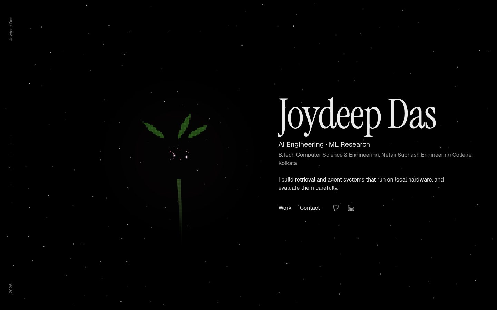

# Portfolio

Personal portfolio for an AI engineer working on retrieval, evaluation and local-first ML systems. It is a single-page site with four sections (Hero, About, Work, Contact) over a full-viewport generative background: a peony flower drawn in Canvas2D and rendered in WebGL as ASCII characters, dots or pixels, with a starfield behind it. Content lives in one file, `src/data/content.js`, and the site is a static Vite build with no backend.

## Scripts

| Command | What it does |
|---|---|
| `npm run dev` | Vite dev server with HMR |
| `npm run build` | Production build to `dist/` |
| `npm run preview` | Serve the production build locally |
| `npm run lint` | ESLint over the project |
| `npm test` | Unit tests (`node --test`) for the content data and the engine's pure modules |
| `npm run test:e2e` | Builds, then runs the Playwright browser tests against the preview server |
| `npm run budget` | Builds, then checks initial JavaScript against the 120 KB gzip budget |
| `npm run measure -- --label <name>` | Builds, then measures frame rate at 1440 px and at 390 px with CPU throttling. Output goes to `.measure/` (git-ignored) |

The browser tests use Playwright's Chromium. Set `CHROMIUM_PATH` to use another build.

## Engine

The background is one `requestAnimationFrame` loop in `src/engine/index.js`. The flower is drawn with Canvas2D into a small offscreen buffer (`flower.js`), which is the only per-frame CPU work of note. A single WebGL fragment shader (`post.frag`, wrapped by `gl.js`) then turns that buffer into the ASCII, dot or pixel rendering, with the glitch, glow and starfield (`particles.js`) in the same pass, so the GPU draws one quad per frame instead of tens of thousands of glyphs. Without WebGL the same modes fall back to Canvas2D. Quality is set by a tier in `quality.js`: `high`, `medium` or `low`, chosen from the device (pointer type, cores, memory), with a frame-time governor that steps the tier down when frames run over budget and back up when there is headroom. Users with `prefers-reduced-motion` (or Save-Data) get the `static` tier: one bloomed frame, no glitch, no parallax, and no content waits on the animation.

## Changing the featured project

Projects are defined in `src/data/content.js` under `PORTFOLIO_DATA.projects`. `Work.jsx` picks the featured card with `featured: true`, and the research card with `pinned: 'research'` on a project that is not featured. Currently AxiomLM has `featured: true` and Testcard has `pinned: 'research'`.

To feature Testcard instead, move the two flags together: set `featured: true` on Testcard and remove it from AxiomLM, then set `pinned: 'research'` on AxiomLM and remove it from Testcard. Then update the assertions in `tests/unit/content.test.js` (the test named "one featured project (axiomlm) and one research pin (testcard)") to match, and run `npm test`.

## Deployment

The site is a plain static build deployed on Vercel. The Vercel project should use `npm run build` with `dist/` as the output directory. `vercel.json` sets the security headers and the long cache lifetime for hashed assets and fonts. There are no Edge Functions and no Image Optimization.

Set `VITE_SITE_URL` (for example `https://example.com`, without a trailing slash) in the Vercel environment. It makes the Open Graph image and `og:url` absolute. If it is unset, the build uses a relative `/og.png` and omits `og:url`. Regenerate `public/og.png` with `node scripts/og-image.mjs` (needs ImageMagick, `magick`) after changing the hero.

## Project media

- Project media: each project has a 16:10 still (`public/work/<id>.webp`, 1640 x 1025) and a muted demo loop (`public/work/<id>.webm` VP9 plus `.mp4` H.264 fallback, 1440 wide, no audio), set as `image` and `video` (path without extension) in `content.js`. Raw sources live in `media/` (git-ignored). After changing a still, run `node scripts/ascii-placeholders.mjs` to regenerate `src/data/placeholders.json`. A demo plays only while it is on screen, never under reduced motion or Save-Data, and has a Pause button.

Type: Clash Grotesk by [Indian Type Foundry](https://www.fontshare.com/fonts/clash-grotesk) (ITF Free Font License, self-hosted in `public/fonts`) and Geist.
